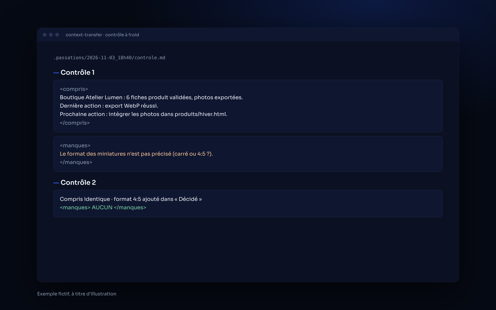
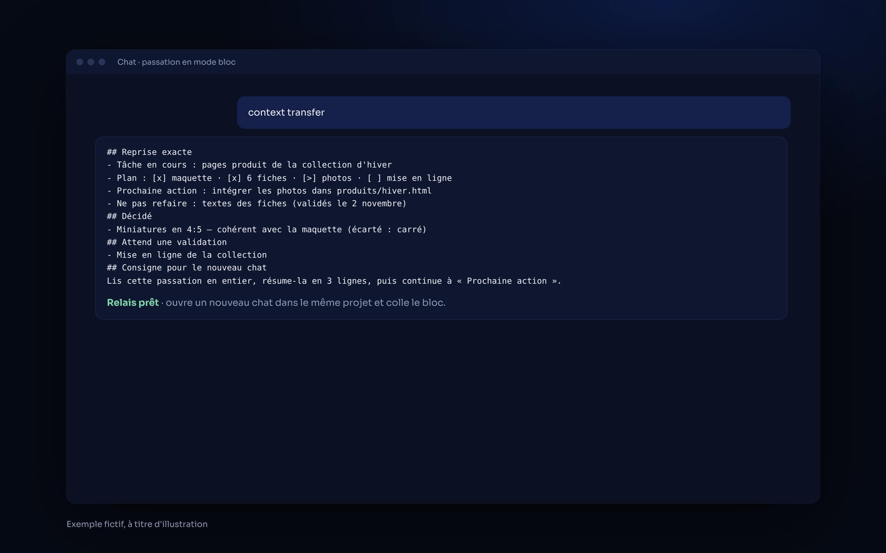

<p align="center">
  
</p>

<p align="center">
  
  
  
</p>

# Context Transfer — reprendre dans un nouveau chat sans rien perdre

**Un skill Claude qui écrit une passation complète : le prochain chat reprend exactement là où tu t'es arrêté, sans refaire ce qui est fait ni reposer de questions.**
*A Claude skill that hands off a long conversation to a fresh one, with nothing lost.*

## ✦ Ce que fait le skill

| | |
|---|---|
| **Passation fidèle** | Chiffres, chemins, commandes, décisions et tes mots exacts sont repris à l'identique. Seuls les politesses, répétitions et essais ratés disparaissent. |
| **Reprise exacte** | Tâche en cours, plan coché, dernière action et son résultat, fichiers touchés, **une** prochaine action vérifiable, et ce qu'il ne faut pas refaire. |
| **Contrôle à froid** | Un lecteur neuf relit la passation et signale ce qui l'empêcherait de reprendre. Le skill corrige, deux tours au maximum. |
| **Deux modes** | *Fichiers* : écrit `STATE.md` et `DECISIONS.md` dans le dossier du projet, avec une sauvegarde datée. *Bloc* : un seul bloc à coller dans un nouveau chat. |
| **Mode reprise** | Le nouveau chat vérifie l'état réel, résume en 3 lignes, puis continue. |
| **Sans risque** | Aucun secret recopié (`[secret retiré]`), aucune publication, aucun envoi : la passation ne fait qu'écrire. |

## ✦ Aperçu

Le contrôle à froid en mode fichiers, puis une passation en mode bloc dans un chat :

<p align="center">
  
  
</p>

<p align="center"><sub><i>Exemple fictif, à titre d'illustration.</i></sub></p>

## ✦ Installation

**Télécharger** : bouton vert **Code → Download ZIP**, ou :

```bash
git clone https://github.com/horizonchapter/context-transfer.git
```

**Claude Code** (pour tous tes projets) :

```bash
cp -r context-transfer/skills/context-transfer ~/.claude/skills/
```

**Claude (app et web)** : importe le fichier [`context-transfer.zip`](context-transfer.zip) dans les réglages des skills de Claude.

## ✦ Utilisation

Dis simplement, à la fin d'une longue conversation :

- « context transfer »
- « passation »
- « relais » ou « nouveau chat »

Dans un nouveau chat, colle le bloc (ou ouvre le même dossier) : Claude applique le mode reprise et continue à la prochaine action.

## ✦ Comment ça marche

```
Conversation longue ──► « context transfer »
        │
        ├── dossier accessible ──► sauvegarde datée ─► STATE.md + DECISIONS.md
        └── chat seul          ──► un bloc à copier-coller
        │
        ▼
Contrôle mécanique (sections, taille, secrets) ─► contrôle à froid (compris / manques)
        │
        ▼
« Relais prêt » ──► nouveau chat : vérifie l'état réel, résume en 3 lignes, continue
```

## ✦ Structure

```
context-transfer/
├── skills/context-transfer/SKILL.md   le skill
├── context-transfer.zip               le même skill, prêt à importer
├── assets/                            bannière et aperçus
├── CHANGELOG.md · CONTRIBUTING.md · SECURITY.md · LICENSE
└── .github/ISSUE_TEMPLATE/            modèles d'issues
```

## ✦ Voir aussi

- [claude-second-brain](https://github.com/horizonchapter/claude-second-brain) : les modèles `CLAUDE.md` / `STATE.md` / `DECISIONS.md` que ce skill remplit.
- [mods-claude-code](https://github.com/horizonchapter/mods-claude-code) : Jauge+, le mod qui déclenche le relais automatiquement dans Claude Code.
- [chef-employe](https://github.com/horizonchapter/chef-employe) · [pdf-luxe](https://github.com/horizonchapter/pdf-luxe) · [claude-routines](https://github.com/horizonchapter/claude-routines)

## ✦ Licence

[MIT](LICENSE). Libre d'utilisation, de modification et de partage.
